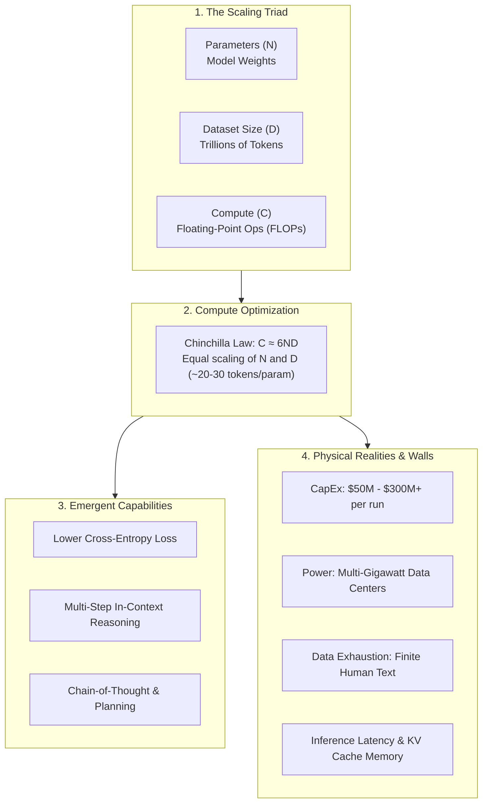
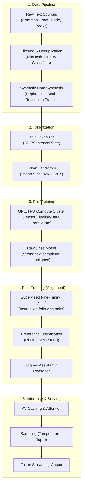

# Aim:	Comprehensive Report on the Fundamentals of Generative AI and Large Language Models (LLMs)
Experiment:
Develop a comprehensive report for the following exercises:
1.	Explain the foundational concepts of Generative AI. 
2.	Focusing on Generative AI architectures. (like transformers).
3.	Generative AI applications.
4.	Generative AI impact of scaling in LLMs.
5.	Explain about LLM and how it is build. 

# Algorithm: Step 1: Define Scope and Objectives
1.1 Identify the goal of the report (e.g., educational, research, tech overview)
1.2 Set the target audience level (e.g., students, professionals)
1.3 Draft a list of core topics to cover
Step 2: Create Report Skeleton/Structure
2.1 Title Page
2.2 Abstract or Executive Summary
2.3 Table of Contents
2.4 Introduction
2.5 Main Body Sections:
•	Introduction to AI and Machine Learning
•	What is Generative AI?
•	Types of Generative AI Models (e.g., GANs, VAEs, Diffusion Models)
•	Introduction to Large Language Models (LLMs)
•	Architecture of LLMs (e.g., Transformer, GPT, BERT)
•	Training Process and Data Requirements
•	Use Cases and Applications (Chatbots, Content Generation, etc.)
•	Limitations and Ethical Considerations
•	Future Trends
2.6 Conclusion
2.7 References
________________________________________
Step 3: Research and Data Collection
3.1 Gather recent academic papers, blog posts, and official docs (e.g., OpenAI, Google AI)
3.2 Extract definitions, explanations, diagrams, and examples
3.3 Cite all sources properly
________________________________________
Step 4: Content Development
4.1 Write each section in clear, simple language
4.2 Include diagrams, figures, and charts where needed
4.3 Highlight important terms and definitions
4.4 Use examples and real-world analogies for better understanding
________________________________________
Step 5: Visual and Technical Enhancement
5.1 Add tables, comparison charts (e.g., GPT-3 vs GPT-4)
5.2 Use tools like Canva, PowerPoint, or LaTeX for formatting
5.3 Add code snippets or pseudocode for LLM working (optional)
________________________________________
Step 6: Review and Edit
6.1 Proofread for grammar, spelling, and clarity
6.2 Ensure logical flow and consistency
6.3 Validate technical accuracy
6.4 Peer-review or use tools like Grammarly or ChatGPT for suggestions
________________________________________
Step 7: Finalize and Export
7.1 Format the report professionally
7.2 Export as PDF or desired format
7.3 Prepare a brief presentation if required (optional)


# Output

# Explain the foundational concepts of Generative AI.

## Prompt

Explain the basic concepts of Generative AI in simple language. Cover its definition, working principle, types, advantages, limitations, and real-world applications. Give suitable examples and a short conclusion.

## ChatGPT Output

### Basic Concepts of Generative AI

#### 1. Definition of Generative AI

Generative Artificial Intelligence (Generative AI) is a type of AI that can create new content, such as text, images, videos, music, and computer code, based on patterns learned from existing data.

Unlike traditional AI, which mainly analyzes data or makes predictions, Generative AI generates new content based on what it has learned during training.

**Examples:**
- ChatGPT generates text and answers questions.
- DALL·E generates images from text prompts.
- GitHub Copilot helps generate computer code.

#### 2. Working Principle of Generative AI

Generative AI learns patterns from large amounts of data and uses them to create new content.

##### Steps Involved

1. **Data Collection:** The model receives training data such as text, images, audio, or code.
2. **Training:** The model learns patterns and relationships in the data.
3. **User Prompt:** The user provides an instruction or question.
4. **Content Generation:** The model uses learned patterns to generate a response.
5. **Output:** The generated content is presented to the user.

**Example:** If a user enters "Write a poem about nature," the AI generates a poem based on the language patterns it has learned.

#### 3. Types of Generative AI

##### 3.1 Text Generation
Creates articles, stories, summaries, and answers.

**Example:** ChatGPT writing an assignment summary.

##### 3.2 Image Generation
Creates images from text descriptions.

**Example:** DALL·E generating an image of a futuristic city.

##### 3.3 Audio and Music Generation
Produces speech, sound effects, and music.

**Example:** AI generating background music for a video.

##### 3.4 Video Generation
Creates or modifies videos using text prompts or images.

**Example:** Generating a short animated video from a written description.

##### 3.5 Code Generation
Generates programming code and helps identify or fix errors.

**Example:** GitHub Copilot suggesting Python code.

#### 4. Advantages of Generative AI

- **Saves Time:** Generates content quickly.
- **Improves Creativity:** Helps create new ideas, designs, and stories.
- **Increases Productivity:** Assists with coding, writing, and data analysis.
- **Supports Learning:** Explains difficult topics in simple language.
- **Automates Tasks:** Helps businesses handle repetitive work.
- **Personalization:** Can adapt content to different user needs.

#### 5. Limitations of Generative AI

- **Incorrect Information:** It may generate answers that sound correct but are false.
- **Bias:** Its outputs can reflect biases in training data.
- **Privacy Risks:** Sharing confidential information with AI tools can expose sensitive data.
- **Dependence on Data:** Output quality depends partly on the training and input data.
- **Limited Understanding:** It can struggle with context, reasoning, and unfamiliar situations.
- **Ethical Concerns:** It may be misused to create fake images, videos, or misleading information.

AI-generated content should be verified before being used for important decisions.

#### 6. Real-World Applications of Generative AI

| Field | Application | Example |
|---|---|---|
| Education | Learning assistance | Explaining programming concepts |
| Healthcare | Documentation support | Drafting clinical notes for review |
| Software Development | Code generation | Generating Python functions |
| Marketing | Content creation | Writing advertisements |
| Entertainment | Media creation | Generating music and visual effects |
| Business | Document automation | Summarizing reports and emails |
| Design | Creative design | Producing logos and illustrations |

#### 7. Conclusion

Generative AI is an important technology that creates new content by learning patterns from existing data. It is widely used in education, healthcare, software development, business, and entertainment.

Although it offers benefits such as increased productivity and creativity, it also has limitations involving accuracy, bias, privacy, and ethical use.

## Gemini Output

### Understanding Generative AI: Core Concepts & Applications

An introductory guide to Generative Artificial Intelligence (GenAI), covering its definitions, foundational mechanisms, model architectures, real-world applications, and current limitations.

---

#### Table of Contents
1. [What is Generative AI?](#what-is-generative-ai)
2. [Generative AI vs. Traditional AI](#generative-ai-vs-traditional-ai)
3. [How Generative AI Works](#how-generative-ai-works)
4. [Core Model Architectures](#core-model-architectures)
5. [Key Advantages](#key-advantages)
6. [Limitations and Risks](#limitations-and-risks)
7. [Real-World Applications](#real-world-applications)
8. [Conclusion](#conclusion)

---

#### What is Generative AI?

**Generative Artificial Intelligence (GenAI)** refers to deep-learning algorithms capable of creating brand-new, original content across various modalities—including text, images, video, synthetic audio, and software code. 

Unlike systems that merely analyze or label existing data, Generative AI models synthesize novel outputs based on the statistical representations and underlying structures they learned during training.

---

#### Generative AI vs. Traditional AI

| Feature | Traditional (Discriminative) AI | Generative AI |
| :--- | :--- | :--- |
| **Primary Goal** | Classify, categorize, or predict labels | Generate new, plausible data artifacts |
| **Core Question** | *"What is the probability of label $Y$ given input $X$?"* ($P(Y \mid X)$) | *"What does new instance $X$ look like?"* ($P(X)$ or $P(X \mid Y)$) |
| **Typical Tasks** | Spam filtering, credit scoring, object detection | Drafting essays, synthesizing voice, writing code, generating art |
| **Output Type** | Discrete labels, probabilities, or numerical values | Unstructured content (media, code, natural language) |

---

#### How Generative AI Works

Generative AI operates through large-scale neural network training rather than rigid programmatic rules or raw data memorization:

```
[Raw Data] -> [Self-Supervised Pre-training] -> [Latent Space / Representations] -> [Prompt / Conditioning] -> [Generated Output]
```

1. **Massive Data Pre-training:** Models ingest enormous amounts of unstructured data (e.g., billions of web pages, source code repositories, visual datasets).
2. **Latent Space & Feature Extraction:** The neural network maps concepts into a high-dimensional mathematical space known as a **latent space**, encoding statistical relationships, semantics, and context.
3. **Inference via Conditioning:** When provided with a prompt (e.g., *"Generate a Python function to parse JSON"*), the model computes the most statistically probable sequence of tokens or visual artifacts that fulfill the instruction.

---

#### Core Model Architectures

Different tasks require distinct neural network architectures:

##### 1. Transformer Models & Large Language Models (LLMs)
* **Mechanism:** Relies on the **self-attention mechanism** to evaluate contextual relationships between all tokens across long sequences simultaneously.
* **Best For:** Natural language understanding, translation, text generation, and programming.
* **Examples:** GPT-4, Gemini, Claude, Llama.

##### 2. Diffusion Models
* **Mechanism:** Adds Gaussian noise to source data in successive steps until it becomes static, then trains a neural network to systematically reverse the process (denoising) to assemble coherent images or video frames.
* **Best For:** High-fidelity photorealistic and artistic image/video synthesis.
* **Examples:** Midjourney, Stable Diffusion, DALL-E, Sora.

##### 3. Generative Adversarial Networks (GANs)
* **Mechanism:** Employs a dual-network game:
  * **Generator:** Fabricates synthetic data samples.
  * **Discriminator:** Tries to differentiate between real data and the generator's fake data.
  * Over iterations, the competition forces the generator to produce virtually indistinguishable outputs.
* **Best For:** Real-time visual synthesis, super-resolution upscaling, style transfer.
* **Examples:** StyleGAN, Deepfake pipelines.

##### 4. Variational Autoencoders (VAEs)
* **Mechanism:** Encodes high-dimensional inputs into a probabilistic latent distribution, then decodes sampled points back into reconstructions with controlled variations.
* **Best For:** Molecular design, anomaly detection, audio synthesis, and image reconstruction.

---

#### Key Advantages

* ⚡ **Accelerated Productivity:** Automates boilerplate tasks like writing unit tests, drafting documentation, and generating boilerplate copy in seconds.
* 🎨 **Enhanced Prototyping:** Allows designers and developers to iterate on visual concepts, wireframes, and design motifs quickly.
* 🎯 **Hyper-Personalization:** Dynamically tailors explanations, product workflows, and support conversations to individual users.
* 🧪 **Synthetic Data Generation:** Generates synthetic datasets to train other machine learning systems without exposing sensitive or private customer information.

---

#### Limitations and Risks

* **Hallucinations:** Generative models prioritize plausibility over factual verification; they can assert falsehoods or create imaginary citations with high confidence.
* **Data Bias:** Models inevitably reflect societal, cultural, and historical biases embedded within their pre-training corpora.
* **Copyright & IP Ambiguities:** Training on public web data creates legal uncertainty concerning fair use and intellectual property ownership.
* **High Compute Footprint:** Training state-of-the-art models requires massive GPU clusters, resulting in significant electrical energy and water-cooling demands.
* **Security Concerns:** Lowers the technical barrier to crafting convincing phishing campaigns, synthetic media (deepfakes), and automated exploit scripts.

---

#### Real-World Applications

| Industry | Primary Use Case | Concrete Example |
| :--- | :--- | :--- |
| **Software Engineering** | Code generation & refactoring | GitHub Copilot suggesting unit tests and algorithm implementations inline. |
| **Biomedicine** | Drug discovery & genomics | DeepMind's AlphaFold predicting protein 3D structures to accelerate therapy design. |
| **Customer Experience** | Conversational triage | Chat agents resolving dynamic multi-turn refund requests without human escalation. |
| **Media & Entertainment** | Pre-visualization & storyboarding | Concept artists producing environmental variations for games and cinema. |
| **Legal & Finance** | Document synthesis & contract auditing | Automating comparative reviews across hundreds of commercial leases. |

---

#### Conclusion

Generative AI shifts computing from passive analysis to active creation. By translating human prompts into complex digital assets, it accelerates innovation across multiple domains. However, because these models operate on mathematical probabilities rather than factual comprehension, optimal implementations pair AI speed with human oversight, validation, and domain expertise.

# Focusing on Generative AI architectures. (like transformers).

## Prompt

Explain the major Generative AI architectures, including GANs, VAEs, diffusion models, and Transformers. Describe how they work, their differences, advantages, and applications with simple examples.

### CHATGPT : 

# Major Generative AI Architectures

Generative AI architectures are models used to learn patterns from data and generate new content, such as text, images, music, videos, and computer code.

The four major architectures are **Generative Adversarial Networks (GANs), Variational Autoencoders (VAEs), Diffusion Models, and Transformers.**


## 1. Generative Adversarial Networks (GANs)

GANs consist of two neural networks that compete with each other to generate realistic content.


### How GANs Work

1. **Generator:** Creates fake data, such as an image of a human face.
2. **Discriminator:** Checks whether the generated data is real or fake.
3. **Competition:** The generator improves its output based on the discriminator's feedback.
4. **Result:** The generator learns to produce increasingly realistic content.

**Example:** Imagine a student creating fake currency and a police officer checking whether it is real. The student improves the fake currency based on the officer's feedback.

### Advantages
- Generates realistic images.
- Useful for image enhancement and editing.
- Learns complex visual patterns.

### Limitations
- Training can be unstable.
- May produce limited varieties of output.
- Requires careful tuning.

### Applications
- Face generation
- Image-to-image translation
- Photo enhancement
- Synthetic training data generation

## 2. Variational Autoencoders (VAEs)

VAEs learn to compress data into a smaller representation and then reconstruct it or generate new examples from that representation.

### How VAEs Work

1. **Encoder:** Compresses input data into a smaller representation.
2. **Latent Space:** Represents important features of the input using a probability distribution.
3. **Decoder:** Uses a sampled representation to reconstruct data or generate new content.
4. **Learning:** The model learns useful representations and generates meaningful outputs.

**Example:** A VAE learns patterns from thousands of handwritten digits and generates a new image resembling the digit `7`.

### Advantages
- Learns useful data representations.
- Supports controlled sampling and generation.
- Helps discover patterns in complex data.

### Limitations
- Generated images can appear blurry.
- Output quality depends on training data.
- Designing a useful latent space can be challenging.

### Applications
- Image generation
- Anomaly detection
- Data compression
- Drug discovery research

## 3. Diffusion Models

Diffusion models generate content by learning to reverse a process that gradually adds noise to data.

### How Diffusion Models Work

1. **Forward Process:** Gradually adds noise to training images until they become almost random noise.
2. **Training:** The model learns to predict and remove the noise.
3. **Generation:** Starts with random noise and repeatedly removes it.
4. **Final Output:** A meaningful image gradually emerges.

**Example:** Imagine a clear picture becoming covered with static. A trained diffusion model learns how to reverse this process, turning random noise into a new picture of a cat.


### Advantages
- Produces high-quality, detailed images.
- Supports text-guided image generation.
- Can generate diverse outputs.

### Limitations
- Generation can require many steps.
- May need significant computing power.
- Fine details and text inside images can still be incorrect.

### Applications
- AI image generation
- Video generation
- Image editing
- Scientific image synthesis

## 4. Transformers

Transformers are neural network architectures that use an attention mechanism to understand relationships between elements in a sequence, such as words in a sentence.


### How Transformers Work

1. **Tokenization:** Converts text into smaller units called tokens.
2. **Embeddings:** Represents tokens as numerical vectors.
3. **Attention Mechanism:** Helps the model identify important relationships between tokens.
4. **Prediction:** Predicts the next token or another target sequence.
5. **Generation:** Repeats the prediction process to generate text, code, or other content.

**Example:** Given the sentence "The sun rises in the ___," a language model may predict "east" as the next word.

### Advantages
- Handles relationships between distant elements in a sequence.
- Can be trained efficiently on large datasets.
- Supports text, code, and multimodal generation.

### Limitations
- Training can require substantial computing resources.
- May generate incorrect or misleading information.
- Can struggle with complex reasoning and very long contexts.

### Applications
- Chatbots such as ChatGPT
- Code assistants
- Language translation
- Text summarization
- Multimodal AI systems

## 5. Comparison of Generative AI Architectures

| Feature | GANs | VAEs | Diffusion Models | Transformers |
|---|---|---|---|---|
| Main Idea | Two networks compete | Encode and decode data | Gradually remove noise | Use attention to model relationships |
| Generation Method | Generator creates samples | Sample a latent representation and decode | Iterative denoising | Predict tokens or sequence elements |
| Main Strength | Realistic images | Structured latent representations | Detailed image generation | Text and sequence generation |
| Main Limitation | Unstable training | Sometimes blurry outputs | Slower generation | High resource requirements |
| Common Application | Synthetic faces | Anomaly detection | Text-to-image generation | Chatbots and coding assistants |

## 6. Real-World Applications

Generative AI architectures are used in different fields depending on the task.

- **GANs:** Generate realistic faces and improve image quality.
- **VAEs:** Learn compact representations and detect unusual patterns in data.
- **Diffusion Models:** Generate images from prompts such as "a robot walking through a futuristic city."
- **Transformers:** Answer questions, summarize documents, translate languages, and generate programming code.

Modern AI systems may combine multiple architectures or use related techniques to improve their capabilities.

## 7. Conclusion

GANs, VAEs, diffusion models, and Transformers are important architectures in Generative AI, but they work differently. GANs learn through competition, VAEs learn compressed representations, diffusion models generate content by removing noise, and Transformers use attention to model sequences and predict tokens.

Understanding these differences helps us choose suitable architectures for applications such as image generation, chatbots, software development, and data analysis.

## Gemini Output

### Deep Dive: Generative AI Architectures

A technical guide covering the four cornerstone architectures powering modern Generative Artificial Intelligence: **Variational Autoencoders (VAEs)**, **Generative Adversarial Networks (GANs)**, **Diffusion Models**, and **Transformers**.

---

#### Table of Contents

- [Architectural Overview](#architectural-overview)
- [1. Variational Autoencoders (VAEs)](#1-variational-autoencoders-vaes)
  - [Intuition](#intuition)
  - [How It Works](#how-it-works)
  - [Mathematical Formulation](#mathematical-formulation)
  - [Trade-offs & Use Cases](#trade-offs--use-cases)
- [2. Generative Adversarial Networks (GANs)](#2-generative-adversarial-networks-gans)
  - [Intuition](#intuition-1)
  - [How It Works](#how-it-works-1)
  - [Mathematical Formulation](#mathematical-formulation-1)
  - [Trade-offs & Use Cases](#trade-offs--use-cases-1)
- [3. Diffusion Models](#3-diffusion-models)
  - [Intuition](#intuition-2)
  - [How It Works](#how-it-works-2)
  - [Mathematical Formulation](#mathematical-formulation-2)
  - [Trade-offs & Use Cases](#trade-offs--use-cases-2)
- [4. Transformers](#4-transformers)
  - [Intuition](#intuition-3)
  - [How It Works](#how-it-works-3)
  - [Mathematical Formulation](#mathematical-formulation-3)
  - [Trade-offs & Use Cases](#trade-offs--use-cases-3)
- [Comparative Architectural Matrix](#comparative-architectural-matrix)
- [Modern Hybrid Pipelines](#modern-hybrid-pipelines)
- [Contributing & License](#contributing--license)

---

#### Architectural Overview

Each architecture approaches the problem of density estimation and sample generation through a distinct mathematical formulation:

| Model Family | Core Mechanism | Objective Type |
| :--- | :--- | :--- |
| **VAE** | Probabilistic latent space compression & sampling | Maximizing Evidence Lower Bound (ELBO) |
| **GAN** | Adversarial game between Generator and Discriminator | Two-player zero-sum minimax optimization |
| **Diffusion** | Stepwise thermodynamic noise removal (reversing Markov chain) | Score matching / Noise prediction (MSE) |
| **Transformer** | Scaled dot-product self-attention across sequence tokens | Cross-entropy next-token prediction |

---

#### 1. Variational Autoencoders (VAEs)

##### Intuition
Think of a VAE as a systematic culinary filing system. Instead of cataloging thousands of individual cake recipes word-for-word, it stores continuous parameters (e.g., sweetness, moisture, density). Even if you pick a coordinate where no explicit recipe previously existed, the decoder produces a consistent, plausible recipe.

##### How It Works

```
Input (x) ──► [ Encoder q_θ(z|x) ] ──► Mean (μ), Log-Variance (log σ²)
                                              │
                                              ▼
                             [ Reparameterization: z = μ + σ ⊙ ε ]
                                              │
                                              ▼
Reconstructed (x̂) ◄── [ Decoder p_ϕ(x|z) ] ◄── Latent Vector (z)
```

1. **Probabilistic Encoding:** Instead of mapping an input $x$ to a single fixed vector, the **Encoder** predicts the statistical distribution parameters: a mean vector $\mu$ and a variance vector $\sigma^2$.
2. **Reparameterization Trick:** Direct sampling from a distribution breaks backpropagation because sampling is non-differentiable. The reparameterization trick decouples stochasticity:
   $$z = \mu + \sigma \odot \epsilon \quad \text{where} \quad \epsilon \sim \mathcal{N}(0, I)$$
3. **Probabilistic Decoding:** The **Decoder** takes sample $z$ and maps it back to reconstructed space $\hat{x}$.

##### Mathematical Formulation
The network is trained to maximize the **Evidence Lower Bound (ELBO)**, equivalent to minimizing:

$$\mathcal{L}_{\text{VAE}}(\theta, \phi; x) = -\mathbb{E}_{q_\phi(z \mid x)}[\log p_\theta(x \mid z)] + D_{\text{KL}}(q_\phi(z \mid x) \parallel p(z))$$

- **Reconstruction Term ($-\mathbb{E}[\log p(x \mid z)]$):** Penalizes deviations between input $x$ and output $\hat{x}$ (typically MSE or Binary Cross-Entropy).
- **Kullback-Leibler (KL) Divergence ($D_{\text{KL}}$):** Enforces that the learned latent distribution closely tracks a standard normal prior $\mathcal{N}(0, I)$, preventing dead space and clustering.

##### Trade-offs & Use Cases
- **Strengths:** Smooth, continuous latent space allows smooth interpolation; theoretically grounded; fast single-pass inference.
- **Weaknesses:** Outputs tend to be blurry because pixel-level MSE loss averages high-frequency details.
- **Real-World Application:** **Molecular discovery and structural biology.** Generating valid molecular graphs by navigating continuous chemical latent spaces.

---

#### 2. Generative Adversarial Networks (GANs)

##### Intuition
A GAN operates like an art forger and an art detective locked in an arms race. The forger (Generator) creates counterfeit artwork, while the detective (Discriminator) judges whether a painting is authentic or forged. As the detective sharpens their eye, the forger is forced to master microscopic realism to fool the critic.

##### How It Works

```
Latent Noise (z) ──► [ Generator G(z) ] ──► Fake Sample (x̂) ┐
                                                             ▼
                                 Real Data (x) ──────► [ Discriminator D ] ──► Probability: Real (1) vs Fake (0)
```

1. **Generator ($G$):** A mapping network that transforms random Gaussian noise $z$ into synthetic data instances $G(z)$.
2. **Discriminator ($D$):** A binary classifier outputting a scalar $D(x) \in [0, 1]$ representing the probability that input $x$ came from real training data rather than $G$.
3. **Adversarial Feedback:** The discriminator updates weights to maximize classification accuracy; the generator updates weights to maximize discriminator misclassifications.

##### Mathematical Formulation
GANs are trained using a zero-sum game via the minimax objective:

$$\min_G \max_D V(D, G) = \mathbb{E}_{x \sim p_{\text{data}}(x)}[\log D(x)] + \mathbb{E}_{z \sim p_z(z)}[\log(1 - D(G(z)))]$$

##### Trade-offs & Use Cases
- **Strengths:** Sharp, photorealistic visual outputs; very fast single-step forward pass inference.
- **Weaknesses:** Unstable training dynamics (vanishing gradients, oscillatory behavior); prone to **mode collapse** (generating only a narrow subset of successful outputs).
- **Real-World Application:** **Real-time game upscaling and video synthesis (e.g., NVIDIA DLSS, StyleGAN).** Ideal for low-latency graphics pipelines where iterative sampling is too slow.

---

#### 3. Diffusion Models

##### Intuition
Imagine dropping food coloring into a glass of water. Over time, the dye particles spread randomly until the water becomes uniformly tinted (entropy increases). If you record this process and play the tape backward frame-by-frame, you can watch the diffuse tint systematically condense back into a concentrated drop. Diffusion models train an artificial neural network to run that reverse process.

##### How It Works

```
Forward Diffusion Process (Fixed, q):
Clean Image (x₀) ──► x₁ ──► x₂ ──► ... ──► Pure Gaussian Noise (x_T)

Reverse Denoising Process (Learned, p_θ):
Pure Noise (x_T) ──► [ Denoising Network (U-Net/DiT) ] ──► x_{T-1} ──► ... ──► Clean Image (x₀)
                               ▲
                      Text Embedding Prompt
```

1. **Forward Process ($q$):** A discrete Markov chain that gradually injects Gaussian noise across $T$ steps using a predetermined variance schedule $\beta_1, \dots, \beta_T$:
   $$q(x_t \mid x_{t-1}) = \mathcal{N}(x_t; \sqrt{1 - \beta_t} x_{t-1}, \beta_t I)$$
2. **Reverse Process ($p_\theta$):** A parameterized neural network (typically a U-Net with attention layers or a Vision Transformer) trained to estimate the noise $\epsilon$ added at arbitrary step $t$.
3. **Sampling:** Starting from pure noise $x_T \sim \mathcal{N}(0, I)$, the model repeatedly subtracts the estimated noise down to step $t=0$, conditioned on text embeddings or class labels.

##### Mathematical Formulation
The simplified training objective (as introduced in DDPM) minimizes the mean squared error between the actual noise $\epsilon$ and the predicted noise $\epsilon_\theta$:

$$\mathcal{L}_{\text{simple}}(\theta) = \mathbb{E}_{t, x_0, \epsilon} \left[ \| \epsilon - \epsilon_\theta(x_t, t) \|^2 \right]$$

where $x_t = \sqrt{\bar{\alpha}_t} x_0 + \sqrt{1 - \bar{\alpha}_t} \epsilon$, and $\bar{\alpha}_t = \prod_{i=1}^t (1 - \beta_i)$.

##### Trade-offs & Use Cases
- **Strengths:** High sample diversity; avoids mode collapse entirely; state-of-the-art fidelity in continuous modalities (images, audio, video).
- **Weaknesses:** Computationally heavy sampling loop requiring multiple sequential forward passes (typically 20–50 steps using solvers like DDIM/DPM-Solver).
- **Real-World Application:** **Text-to-Image and Video Generation (e.g., Midjourney, Stable Diffusion, Runway Gen-2, OpenAI Sora).**

---

#### 4. Transformers

##### Intuition
Earlier sequence models processed text like a human listening to a phone call: word-by-word in strict chronological order, frequently forgetting earlier details as sentences grew longer. A Transformer operates like a researcher reading an entire open page at once, using highlighters to map the connections between every word simultaneously.

##### How It Works

```
Input Tokens ──► Token & Positional Embeddings
                        │
                        ▼
         ┌─────────────────────────────┐
         │ Multi-Head Self-Attention   │ ◄── Q, K, V Projections
         │ Layer Normalization & ResNet│
         │ Feed-Forward Network (FFN)  │
         │ Layer Normalization & ResNet│
         └─────────────────────────────┘  (Repeated across N Layers)
                        │
                        ▼
                 Linear + Softmax
                        │
                        ▼
         Next-Token Probability Distribution
```

1. **Input Representation:** Text is broken into tokens, mapped to dense embeddings, and summed with **Positional Encodings** to retain sequence order without recurrent loops.
2. **Self-Attention:** Allows each token to evaluate its relationship with all other tokens in the sequence simultaneously.
3. **Autoregressive Generation (Decoders):** The model predicts the probability distribution of the subsequent token given prior tokens:
   $$P(W) = \prod_{i=1}^n P(w_i \mid w_1, w_2, \dots, w_{i-1})$$

##### Mathematical Formulation
The core engine is **Scaled Dot-Product Attention**, which maps Query ($Q$), Key ($K$), and Value ($V$) matrices:

$$\text{Attention}(Q, K, V) = \text{softmax}\left(\frac{QK^T}{\sqrt{d_k}}\right)V$$

- **$QK^T$:** Calculates pairwise dot products between all tokens to determine raw attention scores.
- **$\sqrt{d_k}$:** Scaling factor proportional to key dimensionality, preventing gradient vanishing in softmax.
- **$\text{softmax}(\dots)V$:** Normalizes scores into probabilities ($0$ to $1$) and weights the value vectors accordingly.

##### Trade-offs & Use Cases
- **Strengths:** Exceptionally parallelizable during training; handles long-range contextual relationships; exhibits strong empirical scaling laws with compute and data.
- **Weaknesses:** Standard full attention requires quadratic time and memory complexity $\mathcal{O}(N^2)$ relative to context length $N$; high GPU memory (KV cache) usage during generation.
- **Real-World Application:** **Large Language Models and Code Assistants (e.g., GPT-4, Claude, Gemini, GitHub Copilot).**

---

#### Comparative Architectural Matrix

| Dimension | Variational Autoencoders (VAEs) | Generative Adversarial Networks (GANs) | Diffusion Models | Transformers (Autoregressive) |
| :--- | :--- | :--- | :--- | :--- |
| **Primary Domain** | Structural biology, compression | Real-time graphics, super-resolution | Image, audio, and video synthesis | Text, code, reasoning, agentic planning |
| **Inference Cost** | Low ($\mathcal{O}(1)$ forward pass) | Low ($\mathcal{O}(1)$ forward pass) | High ($\mathcal{O}(T)$ iterative passes) | Proportional to generated sequence length |
| **Training Stability** | High (Convex ELBO surrogate) | Low (Minimax instability, mode collapse) | High (Direct MSE loss) | High (Standard Cross-Entropy loss) |
| **Sample Quality** | Moderate (Blurry outputs) | High (Sharp, fine details) | State-of-the-Art (High fidelity & diversity) | State-of-the-Art (Contextual accuracy) |
| **Latent Space** | Continuous & probabilistically smooth | Discontinuous, difficult to invert | High-dimensional intermediate states | Dense continuous token embedding spaces |

---

#### Modern Hybrid Pipelines

Modern production AI rarely uses an individual architecture in isolation; contemporary models compose these architectures into unified systems:

```
User Prompt: "A cybernetic falcon flying through a neon canyon"
                            │
                            ▼
           [ Transformer (e.g., T5 / CLIP Text Encoder) ]
                            │  Extracts semantic conditioning embeddings
                            ▼
               [ Latent Diffusion Backbone ]
     Iteratively denoises a low-dimensional feature representation
                            │
                            ▼
                  [ VAE Decoder (Latent Space -> Pixel Space) ]
            Expands compact latent tensors into full 4K visual frames
```

- **Latent Diffusion (e.g., Stable Diffusion):** Uses a **Transformer** to parse text prompts, runs a **Diffusion Model** inside a compressed latent space to drastically reduce compute costs, and uses a **VAE Decoder** to unpack the latent array into clean pixel outputs.
- **Diffusion Transformers (DiT / Sora):** Replaces the traditional convolutional U-Net core in diffusion systems with a **Transformer backbone**, allowing image and video generators to inherit the predictable scaling laws of large language models.

---

# Generative AI architecture  and its applications.

## Prompt

Explain the applications of Generative AI in education, healthcare, business, entertainment, software development, and cybersecurity. Give real-world examples, benefits, limitations, and a short conclusion.

## ChatGPT Output

### Applications of Generative AI

Generative Artificial Intelligence (Generative AI) is used to create new content, generate ideas, analyze information, and automate tasks. It is widely applied in education, healthcare, business, entertainment, software development, and cybersecurity.

#### 1. Education

Generative AI helps students learn more effectively and assists teachers in preparing educational materials.

##### Applications
- Generates notes, summaries, and practice questions.
- Explains difficult concepts in simple language.
- Helps teachers prepare lesson plans and quizzes.
- Supports personalized learning based on student needs.

##### Real-World Example
**ChatGPT** can explain programming concepts, summarize study materials, and generate practice questions for exams.

##### Benefits
- Makes learning easier and faster.
- Provides personalized learning support.
- Saves time for students and teachers.

##### Limitations
- May provide incorrect answers.
- Excessive dependence can reduce independent learning.
- AI-generated assignments may raise academic integrity concerns.

#### 2. Healthcare

Generative AI assists healthcare professionals with documentation, medical research, and patient communication.

##### Applications
- Drafts clinical notes and medical reports.
- Summarizes medical documents.
- Supports medical research and drug discovery.
- Generates synthetic medical data for research.

##### Real-World Example
**Microsoft Dragon Copilot** assists healthcare professionals with clinical documentation and administrative tasks.

##### Benefits
- Reduces documentation workload.
- Helps organize medical information.
- Supports research and innovation.

##### Limitations
- May generate inaccurate medical information.
- Patient privacy must be protected.
- Medical decisions require qualified healthcare professionals.

#### 3. Business

Businesses use Generative AI to improve productivity, communicate with customers, and automate routine tasks.

##### Applications
- Generates emails, reports, and presentations.
- Creates marketing content and product descriptions.
- Summarizes meetings and business documents.
- Supports customer service through AI assistants.

##### Real-World Example
**Microsoft 365 Copilot** helps users draft emails, summarize documents, and analyze information across supported Microsoft 365 applications.

##### Benefits
- Saves time and operational costs.
- Improves employee productivity.
- Supports faster content creation.

##### Limitations
- Generated information may contain errors.
- Sensitive business data requires protection.
- Human review is needed for important decisions.

#### 4. Entertainment

Generative AI helps create digital content for movies, games, music, and other forms of entertainment.

##### Applications
- Generates images, music, and videos.
- Helps develop game characters and story ideas.
- Creates visual effects and concept art.
- Assists with animation and creative design.

##### Real-World Example
**Adobe Firefly** helps creators generate and edit images and other creative content using AI-powered tools.

##### Benefits
- Encourages creativity.
- Speeds up content production.
- Helps independent creators explore new ideas.

##### Limitations
- Raises copyright and ownership concerns.
- Can generate unrealistic or inconsistent content.
- May be misused to create deepfakes and misleading media.

#### 5. Software Development

Generative AI helps developers write, understand, test, and improve computer programs.

##### Applications
- Generates code from natural-language instructions.
- Explains unfamiliar code.
- Suggests fixes for programming errors.
- Generates test cases and documentation.

##### Real-World Example
**GitHub Copilot** suggests code, helps explain programming concepts, and assists developers with software tasks.

##### Benefits
- Speeds up software development.
- Helps beginners learn programming.
- Reduces repetitive coding work.

##### Limitations
- Generated code may contain bugs.
- Suggestions may introduce security vulnerabilities.
- Developers must review and test the output.

#### 6. Cybersecurity

Generative AI can assist security teams in analyzing threats, understanding alerts, and investigating suspicious activities.

##### Applications
- Summarizes security alerts and incident reports.
- Helps analysts understand suspicious log entries.
- Assists with security documentation and investigation workflows.
- Supports security awareness training through simulated phishing examples.

##### Real-World Example
**Microsoft Security Copilot** helps security professionals investigate incidents, summarize threats, and support security operations.

##### Benefits
- Helps analysts process large amounts of information.
- Can speed up incident investigation.
- Supports security training and reporting.

##### Limitations
- May incorrectly interpret security events.
- Attackers can misuse AI to create convincing phishing messages.
- Sensitive security data must be handled carefully.
- Human verification is essential before taking security actions.

#### 7. Comparison of Applications

| Field | Main Application | Example Tool | Key Benefit |
|---|---|---|---|
| Education | Personalized learning | ChatGPT | Easier learning |
| Healthcare | Clinical documentation | Microsoft Dragon Copilot | Reduced administrative workload |
| Business | Document and email assistance | Microsoft 365 Copilot | Increased productivity |
| Entertainment | Image and content generation | Adobe Firefly | Faster creative work |
| Software Development | Code generation | GitHub Copilot | Faster coding |
| Cybersecurity | Threat investigation | Microsoft Security Copilot | Faster security analysis |

## Gemini Output

### Real-World Applications of Generative AI: Industry Breakdown

A practical, production-oriented reference guide analyzing the real-world deployment of Generative Artificial Intelligence across six core industries: **Education**, **Healthcare**, **Business**, **Entertainment**, **Software Engineering**, and **Cybersecurity**.

---

#### Table of Contents

- [Industry Landscape Overview](#industry-landscape-overview)
- [1. Education](#1-education)
  - [Key Applications](#key-applications)
  - [Real-World Case Studies](#real-world-case-studies)
  - [Benefits & Limitations](#benefits--limitations)
- [2. Healthcare & Life Sciences](#2-healthcare--life-sciences)
  - [Key Applications](#key-applications-1)
  - [Real-World Case Studies](#real-world-case-studies-1)
  - [Benefits & Limitations](#benefits--limitations-1)
- [3. Business & Enterprise](#3-business--enterprise)
  - [Key Applications](#key-applications-2)
  - [Real-World Case Studies](#real-world-case-studies-2)
  - [Benefits & Limitations](#benefits--limitations-2)
- [4. Media & Entertainment](#4-media--entertainment)
  - [Key Applications](#key-applications-3)
  - [Real-World Case Studies](#real-world-case-studies-3)
  - [Benefits & Limitations](#benefits--limitations-3)
- [5. Software Development](#5-software-development)
  - [Key Applications](#key-applications-4)
  - [Real-World Case Studies](#real-world-case-studies-4)
  - [Benefits & Limitations](#benefits--limitations-4)
- [6. Cybersecurity](#6-cybersecurity)
  - [Key Applications](#key-applications-5)
  - [Real-World Case Studies](#real-world-case-studies-5)
  - [Benefits & Limitations](#benefits--limitations-5)
- [Cross-Industry Comparative Matrix](#cross-industry-comparative-matrix)
- [Deployment Best Practices](#deployment-best-practices)
- [Conclusion](#conclusion)
- [Contributing & License](#contributing--license)

---

#### Industry Landscape Overview

Generative Artificial Intelligence is shifting enterprise software from deterministic tools that follow rigid rules to probabilistic engines that synthesize, reason, and draft novel outputs.

```
┌────────────────────────────────────────────────────────────────────────┐
│                      Generative Foundation Models                      │
│            (Large Language Models, Diffusion Systems, VAEs)            │
└───────┬────────────┬────────────┬─────────────┬────────────┬───────────┘
        │            │            │             │            │
        ▼            ▼            ▼             ▼            ▼
   [Education]  [Healthcare]  [Business]  [Entertainment] [Software]  [Cybersecurity]
     Adaptive     De Novo      Procurement    Procedural     Pair        SOC Alert
     Tutoring   Drug Design    Negotiation      Assets     Coding & CI     Triage
```

---

#### 1. Education

Generative AI enables 1-on-1 tutoring at population scale, tailored curriculum design, and automated assessment drafting.

##### Key Applications
* **Adaptive Socratic Tutoring:** Guiding learners step-by-step through mathematical and conceptual proofs by asking clarifying questions rather than providing direct solutions.
* **Dynamic Reading Level Adaptation:** Rewriting technical papers or classic literature into varying reading tiers (e.g., elementary, high school, undergraduate, ESL).
* **Automated Educator Scaffolding:** Generating multi-tiered lesson plans, standardized test questions, and rubric-calibrated evaluation suggestions.

##### Real-World Case Studies
* **Khan Academy (Khanmigo):** An LLM-powered interactive assistant that acts as a personal tutor for students and an instructional assistant for teachers, enforcing a strict pedagogical rule: never output the answer outright.
* **Duolingo (Duolingo Max):** Integrates generative models to power "Explain My Answer" (contextual error breakdown) and "Roleplay" (open-ended conversational practice tailored to user proficiency).

##### Benefits & Limitations
* **Benefits:** Expands access to personalized coaching; reduces instructional administrative overhead; accommodates non-linear learning paces.
* **Limitations:** Prone to mathematical and factual hallucinations; risks diminishing student critical thinking if used as an answer shortcut; highlights technological equity divides across underfunded school districts.

---

#### 2. Healthcare & Life Sciences

Generative AI assists in biomedical research, patient communication, and ambient clinical documentation.

##### Key Applications
* **De Novo Molecular Design:** Sampling valid chemical graphs and predicting 3D macromolecular structures to synthesize targeted drug candidates.
* **Ambient Clinical Scribing:** Transcribing unscripted doctor-patient consultations in real time and structuring dialogue into standardized Electronic Health Record (EHR) notes.
* **Synthetic Medical Imagery:** Generating high-resolution, privacy-compliant synthetic pathology slides and CT scans to train downstream diagnostic computer vision classifiers.

##### Real-World Case Studies
* **Insilico Medicine:** Utilized generative biology models to identify a novel target and design a small-molecule inhibitor for idiopathic pulmonary fibrosis (IPF), progressing to human clinical trials in under 30 months.
* **Nuance DAX Copilot (Microsoft):** Ambient clinical listening software deployed across major hospital networks that records physician-patient encounters and produces structured, billable clinical documentation.

##### Benefits & Limitations
* **Benefits:** Compresses early drug-discovery lead optimization from years to months; reduces clinician documentation burnout; preserves HIPAA/GDPR compliance via synthetic datasets.
* **Limitations:** Zero tolerance for hallucinations (contraindicated recommendations can cause direct patient harm); models trained on biased clinical cohorts produce uneven diagnostic performance across demographic groups.

---

#### 3. Business & Enterprise

Generative AI transforms core operations by automating analytical reporting, multi-channel customer workflows, and vendor interactions.

##### Key Applications
* **Dynamic Contract Intelligence:** Extracting indemnity clauses, synthesizing covenants, and flagging non-standard terms across thousands of procurement documents.
* **Multi-Turn Autonomous Support:** Deploying goal-directed conversational agents capable of resolving multi-step support inquiries (e.g., returns, account updates, cross-border shipping disputes).
* **Hyper-Personalized Marketing:** Generating targeted email copy, demographic-specific advertising creatives, and localized catalog assets on demand.

##### Real-World Case Studies
* **Walmart:** Implemented automated negotiation assistants to negotiate cost terms and commercial agreements with long-tail suppliers, automating standard procurement rounds and saving millions.
* **Morgan Stanley Wealth Management:** Deployed an internal GPT-based search and synthesis engine across 100,000+ proprietary investment research reports to give advisors instant, verifiable market insights.

##### Benefits & Limitations
* **Benefits:** 24/7 customer service coverage; reduction in routine contract cycle times by up to 60%; instant synthesis of siloed internal knowledge bases.
* **Limitations:** Data leak risks when confidential IP or PII is sent to external APIs; brand voice and accuracy risks when customer-facing models misstate return policies or pricing guarantees.

---

#### 4. Media & Entertainment

Generative models function as production-grade accelerators across visual concept design, interactive gaming, and cinematic post-production.

##### Key Applications
* **Dynamic Non-Player Characters (NPCs):** Generating unscripted, branching, context-aware character dialogues based on gameplay states and player behavior.
* **Visual Pre-Visualization & Concept Art:** Translating script descriptions into rapid storyboards, concept paintings, and high-fidelity texture maps.
* **Automated Audio Localization:** Generating translated dialogue dubbed into multiple languages while preserving the original actor's vocal timbre, emotion, and lip-sync cadence.

##### Real-World Case Studies
* **Ubisoft (Ghostwriter):** An in-house narrative writing tool that generates initial drafts of background NPC chatter ("barks") triggered during gameplay events, freeing scriptwriters for core narrative arcs.
* **Runway (Gen-2 / Gen-3 Alpha):** High-definition text-to-video diffusion models employed by indie filmmakers and commercial creative agencies to generate background visual effects, animations, and pre-vis assets.

##### Benefits & Limitations
* **Benefits:** Substantially lowers production costs for indie studios; shortens iteration cycles from weeks to minutes; enables responsive storytelling in interactive media.
* **Limitations:** Ongoing copyright litigation over training data rights; ethical concerns regarding likeness and voice cloning; temporal inconsistencies and visual artifacts in multi-second video rendering.

---

#### 5. Software Development

Generative AI acts as an interactive pair programmer, assisting throughout the software lifecycle: code generation, refactoring, and test automation.

##### Key Applications
* **Contextual Code Completion:** Suggesting complete function implementations, API routes, and standard boilerplate directly inside the IDE.
* **Legacy Stack Migration:** Converting legacy software codebases (e.g., COBOL, older Fortran routines, legacy Java versions) into modern cloud-native architectures.
* **Automated Test Scaffolding:** Generating unit test suites, integration fixtures, synthetic mocks, and pull-request descriptions automatically.

##### Real-World Case Studies
* **GitHub Copilot:** Integrated into developer environments to predict code blocks from inline comments and surrounding code context, significantly increasing task completion velocity.
* **Cursor IDE:** An AI-first code editor designed to ingest multi-file repository contexts, refactoring dependencies and generating complex cross-file modifications from natural-language instructions.

##### Benefits & Limitations
* **Benefits:** Cuts repetitive boilerplate coding by 30–50%; lowers barrier to entry for unfamiliar frameworks; speeds up documentation and unit test coverage.
* **Limitations:** Code security vulnerabilities (recommending outdated libraries, insecure regex, or hard-coded secrets); license contamination risks when open-source code is reproduced verbatim without attribution.

---

#### 6. Cybersecurity

Generative AI acts as an operational multiplier for Security Operations Center (SOC) teams, but also creates novel asymmetric attack surfaces.

##### Key Applications
* **SOC Telemetry Synthesis:** Parsing millions of event logs across SIEM platforms and translating raw hex and firewall dumps into structured threat narratives.
* **Detection Rule Generation:** Instantly generating targeted detection signatures (e.g., YARA rules, Sigma rules, KQL queries) in response to newly published CVE disclosures.
* **Automated Attack Simulation:** Generating customized phishing simulations to train enterprise employees against evolving social engineering patterns.

##### Real-World Case Studies
* **Microsoft Security Copilot:** Ingests raw telemetry across security endpoints, summarizes incident timelines, and generates reverse-engineering scripts for SOC analysts during live breaches.
* **Google Cloud Security AI Workbench (Sec-PaLM):** Tailored security model that parses complex attack graphs, analyzes malicious scripts, and flags vulnerabilities across cloud infrastructure.

##### Benefits & Limitations
* **Benefits:** Substantially lowers Mean Time to Detect (MTTD) and Mean Time to Respond (MTTR); counters analyst burnout; democratizes deep forensic analysis.
* **Limitations:** Dual-use threat—adversaries use identical architectures to generate polymorphic malware, automate spear-phishing campaigns at scale, and discover zero-day exploits.

---

#### Cross-Industry Comparative Matrix

| Industry | Primary Value Driver | Benchmark Application | Primary Risk Vector | Human-in-the-Loop Requirement |
| :--- | :--- | :--- | :--- | :--- |
| **Education** | Personalized instruction | Socratic tutoring & level translation | Hallucinations & passive reliance | **Medium** (Teacher validation) |
| **Healthcare** | Research & paperwork reduction | Ambient scribing & molecular design | Patient harm & medical errors | **Critical** (Physician sign-off) |
| **Business** | Operational scalability | Contract review & customer agents | Data leaks & inaccurate financial data | **Medium to High** (Auditing required) |
| **Entertainment**| Rapid visual iteration | Concept art & dynamic game barks | Copyright disputes & voice rights | **Medium** (Art direction required) |
| **Software Dev** | Developer throughput | Autocomplete, migration & unit tests | Insecure code & license contamination | **High** (Peer review & CI/CD checks) |
| **Cybersecurity**| Rapid threat response | SOC incident summaries & YARA rules | Adversarial AI & dual-use attacks | **Critical** (Security analyst verification)|

---

#### Deployment Best Practices

To deploy Generative AI responsibly across mission-critical domains, systems should adhere to three foundational architectural patterns:

```
                  ┌──────────────────────────────┐
                  │    User / System Prompt      │
                  └──────────────┬───────────────┘
                                 │
                                 ▼
                  ┌──────────────────────────────┐
                  │ Retrieval-Augmented Gen (RAG)│ ◄── Grounding on trusted internal data
                  └──────────────┬───────────────┘
                                 │
                                 ▼
                  ┌──────────────────────────────┐
                  │ Safety & Guardrail Layer     │ ◄── PII masking, toxicity & prompt injection filters
                  └──────────────┬───────────────┘
                                 │
                                 ▼
                  ┌──────────────────────────────┐
                  │ Human Verification Gate      │ ◄── Human-in-the-Loop review before execution
                  └──────────────┬───────────────┘
                                 │
                                 ▼
                  ┌──────────────────────────────┐
                  │    Execution / Production    │
                  └──────────────────────────────┘
```

1. **Retrieval-Augmented Generation (RAG):** Constrain generative model responses to verified internal databases and documentation to minimize hallucinations.
2. **Defensive Guardrails:** Implement intermediate filtering layers (e.g., NeMo Guardrails, Llama Guard) to intercept prompt injections, sensitive data exposure, and toxic outputs.
3. **Mandatory Human-in-the-Loop (HITL):** Require authenticated domain-expert sign-off before executing high-impact medical, financial, legal, or deployment actions.

---

#### Conclusion

Generative AI marks a transition from deterministic data processing to probabilistic synthesis. Across every major sector—from designing molecules in healthcare to securing infrastructure in cybersecurity—the technology offers substantial productivity gains. 

However, because these systems predict probable outputs rather than verifying ground-truth reality, their enterprise viability depends on strict technical governance: pairing foundation models with robust retrieval pipelines, defensive guardrails, and persistent human oversight.

---

# Generative AI impact of scaling in LLMs.

## Prompt

Explain how scaling affects Large Language Models (LLMs). Discuss model size, training data, computing power, performance, reasoning, cost, energy consumption, and limitations using simple examples.

## ChatGPT Output

### How Scaling Affects Large Language Models (LLMs)

Scaling refers to increasing the **model size, training data, and computing power** used to build a Large Language Model (LLM). Scaling can improve an AI model's ability to understand language, answer questions, write code, and solve problems. However, it also increases costs and energy consumption.

#### Infographic


#### 1. Model Size

Model size refers to the number of parameters in a model. Parameters are values learned during training that help the model process information and generate responses.

- Larger models can learn more complex patterns.
- They may perform better on a wider range of tasks.
- They require more memory and computing resources.

**Example:** A small model may give a basic explanation of Python, while a larger model may explain the concept, provide code, and identify common errors.

#### 2. Training Data

Training data includes text, books, websites, code, and other information used to train the model.

- More data can expose the model to more topics and language patterns.
- High-quality data can improve learning and reliability.
- Poor-quality or biased data can lead to incorrect or unfair outputs.

**Example:** A model trained on diverse programming examples may learn more programming patterns than one trained on a small collection of examples.

#### 3. Computing Power

Computing power is the processing capacity used to train and run an LLM. GPUs and TPUs are commonly used for this purpose.

- More computing resources can support larger models and datasets.
- Multiple processors can work together to speed up training.
- More computing power also increases infrastructure and electricity costs.

**Example:** Training a large language model may require many GPUs working together for weeks or months.

#### 4. Effect on Performance

Scaling often improves a model's accuracy, language understanding, coding ability, and response quality.

**Example:** A smaller model might provide a short answer to a question, while a larger model may provide a detailed explanation with examples.

However, improvements are not guaranteed for every task. Performance depends on the model architecture, training data, training methods, and evaluation method.

#### 5. Effect on Reasoning

Larger models can sometimes perform better at multi-step tasks, logical problems, and complex instructions.

**Example:** A small model may struggle with a multi-step mathematics problem, while a larger model may break it into steps and reach the correct answer.

However, larger models can still make logical mistakes or produce convincing but incorrect answers.

#### 6. Cost

Scaling increases the cost of training, deploying, and maintaining LLMs.

Major expenses include:
- GPUs and specialized hardware.
- Data storage and processing.
- Cloud computing services.
- Electricity and ongoing inference costs.

**Example:** A company operating a large AI chatbot may need substantial computing resources to answer thousands of user requests.

#### 7. Energy Consumption

Training and running large models require electricity to power computing hardware and cooling systems.

- Larger training workloads generally consume more energy.
- High usage can increase the energy needed to serve users.
- Efficient hardware, smaller models, and quantization can reduce resource requirements.

**Example:** A company can use a smaller, optimized model for simple customer questions instead of sending every request to its largest model.

#### 8. Limitations of Scaling

Despite its benefits, scaling has several limitations:

- **Diminishing Returns:** Each additional increase in size may produce smaller improvements.
- **Hallucinations:** Models can generate false information.
- **Bias:** Training data can introduce unfair or inaccurate patterns.
- **High Resource Requirements:** Large models can be expensive to train and operate.
- **Reasoning Limitations:** More parameters do not guarantee correct reasoning.
- **Data Limitations:** More data is not necessarily better if it is low quality or repetitive.

#### 9. Conclusion

Scaling is an important factor in developing powerful Large Language Models. Increasing model size, training data, and computing power can improve performance and reasoning capabilities. However, scaling also increases cost, energy consumption, and infrastructure requirements.

Therefore, the goal is not simply to build the largest model, but to develop an efficient and reliable model that performs well for its intended purpose.

## Gemini Output

### Scaling Large Language Models (LLMs): Principles, Dynamics & Limitations

A technical guide explaining how scaling model size, dataset volume, and computational capacity impacts the performance, reasoning capabilities, financial cost, and physical footprint of Large Language Models.

---

#### Table of Contents

- [Overview: The Scaling Hypothesis](#overview-the-scaling-hypothesis)
- [The Scaling Triad](#the-scaling-triad)
- [Visualizing the Scaling Dynamics](#visualizing-the-scaling-dynamics)
- [Compute-Optimal Scaling: The Chinchilla Paradigm](#compute-optimal-scaling-the-chinchilla-paradigm)
- [Performance & Reasoning Emergence](#performance--reasoning-emergence)
  - [Cross-Entropy Loss & Predictable Scaling](#cross-entropy-loss--predictable-scaling)
  - [Reasoning & Chain-of-Thought (CoT)](#reasoning--chain-of-thought-cot)
  - [Pre-Training vs. Test-Time Compute](#pre-training-vs-test-time-compute)
- [Resource Footprint: Compute, Capital & Energy](#resource-footprint-compute-capital--energy)
- [Bottlenecks & Diminishing Returns](#bottlenecks--diminishing-returns)
- [Comparative Summary Matrix](#comparative-summary-matrix)
- [Conclusion](#conclusion)
- [References & Further Reading](#references--further-reading)

---

#### Overview: The Scaling Hypothesis

The **Scaling Hypothesis** posits that language model capability is primarily a function of three variables:

1. **Parameter count ($N$):** The internal capacity and expressiveness of the neural network.
2. **Dataset size ($D$):** The number of tokens seen during training.
3. **Compute budget ($C$):** The total floating-point operations ($\text{FLOPs}$) used to optimize the model.

Rather than experiencing random fluctuations in capability, LLMs exhibit strong empirical regularities known as **Power Laws**. When these inputs scale together, test loss drops along a predictable trajectory:

$$L(N) \propto N^{-\alpha_N}, \quad L(D) \propto D^{-\alpha_D}, \quad L(C) \propto C^{-\alpha_C}$$

---

#### The Scaling Triad

```
                       [ Compute (C) ]
                   Total Training FLOPs
                      /              \
                     /                \
                    /                  \
    [ Parameters (N) ] ────────────── [ Tokens (D) ]
    Model Capacity / Weights          Training Dataset Size
```

##### 1. Model Size (Parameters, $N$)
* **Definition:** The tunable weights within the self-attention heads, feed-forward sublayers, and layer normalization steps.
* **Analogy:** The cognitive capacity or "mental storage" of a student.
* **Scaling Effect:** A $7\text{B}$ parameter model must aggressively compress information, preserving only frequent statistical patterns. A $70\text{B}$ or $400\text{B}$ parameter network retains subtle edge cases, foreign languages, obscure historical events, and complex programming syntax.

##### 2. Training Data (Tokens, $D$)
* **Definition:** Text converted into numerical sub-word units ($\approx 0.75 \text{ words per token}$).
* **Analogy:** The total library of books, code files, and papers the student reads during training.
* **Scaling Effect:** Scaling tokens prevents overfitting and allows the model to learn context-dependent associations rather than memorizing surface-level phrasing.

##### 3. Compute Budget (FLOPs, $C$)
* **Definition:** The total floating-point calculations executed across GPU/TPU clusters. Under standard Transformer architectures, forward and backward passes consume approximately:

$$C \approx 6 \times N \times D \text{ FLOPs}$$

* **Analogy:** The total study and revision time invested under high cognitive intensity.
* **Scaling Effect:** Dictates the upper bound of how large a model can be trained on a given token volume within practical engineering timelines.

---

#### Visualizing the Scaling Dynamics

The following architecture diagram demonstrates how scaling inputs pass through compute-optimal allocation into performance milestones and hardware constraints:



---

#### Compute-Optimal Scaling: The Chinchilla Paradigm

In 2020, early empirical findings (Kaplan et al., OpenAI) suggested that parameter count should scale more aggressively than training tokens as compute increased:

$$\text{Kaplan Ratio (Outdated): } N \propto C^{0.73}, \quad D \propto C^{0.27}$$

This led to models like **GPT-3** ($175\text{B}$ parameters trained on only $300\text{B}$ tokens), which were compute-suboptimal and heavily undertrained.

In 2022, DeepMind published the **Chinchilla** scaling laws (Hoffmann et al.), showing that for compute optimality, parameters and tokens should scale in **equal proportion**:

$$N \propto C^{0.5}, \quad D \propto C^{0.5}$$

```
Compute Budget Comparison:
┌────────────────────────┬──────────────────────┬──────────────────────┐
│ Model                  │ Parameters (N)       │ Training Tokens (D)  │
├────────────────────────┼──────────────────────┼──────────────────────┤
│ Gopher (Kaplan-era)    │ 280 Billion          │ 300 Billion          │
│ Chinchilla (Optimal)   │ 70 Billion           │ 1.4 Trillion         │
│ Llama 3 (Over-trained) │ 8 Billion            │ 15.0 Trillion        │
└────────────────────────┴──────────────────────┴──────────────────────┘
```

> **The Golden Ratio:** Dense foundation models should be exposed to at least **$20 \text{ to } 30 \text{ tokens}$ per parameter** during pre-training to balance training efficiency with inference cost. Recent open models (like Llama 3) intentionally over-train small models ($8\text{B}$ parameters on $15\text{T}$ tokens) to lower downstream serving costs.

---

#### Performance & Reasoning Emergence

##### Cross-Entropy Loss & Predictable Scaling
Test loss follows a smooth, unbroken power law over many orders of magnitude of compute. As loss drops, models develop finer probabilistic discrimination between syntactically correct and factually accurate completions.

```
Cross-Entropy
Loss (L)
  │
  │───\
  │    \
  │     \  Power Law Curve: L(C) = (C_c / C)^α
  │      \
  │       \───\
  │            \───────
  └──────────────────────── Compute (FLOPs)
```

##### Reasoning & Chain-of-Thought (CoT)
While raw token loss decreases smoothly, benchmark evaluation metrics (e.g., GSM8k for math, HumanEval for code) often show non-linear jumps in performance:

* **Small Models ($\le 7\text{B}$):** Stumble on multi-step reasoning because they attempt to predict the final output directly in a single pass without intermediate state tracking.
* **Large / Scaled Models ($\ge 70\text{B}$):** Leverage internal activation depth to maintain intermediate variables, self-correct errors, and execute step-by-step reasoning paths.

##### Pre-Training vs. Test-Time Compute
Frontier scaling no longer relies solely on pre-training compute. Modern reasoning models scale **test-time compute (inference compute)**:

$$\text{Capability} \propto f(\text{Pre-training Compute}) + g(\text{Inference-Time Search / Verification})$$

* Models generate hundreds of candidate reasoning chains.
* Process Reward Models (PRMs) evaluate intermediate steps.
* Monte Carlo Tree Search (MCTS) or search-over-tokens prunes invalid logic before presenting the final response.

---

#### Resource Footprint: Compute, Capital & Energy

| Parameter Tier | Hardware Footprint | Est. Training Cost | Est. Power Required | Typical Target Use |
| :--- | :--- | :--- | :--- | :--- |
| **Small ($\approx 7\text{B} - 8\text{B}$)** | 512 to 1,024 GPUs for 2–3 weeks | $\$200\text{K} - \$1\text{M}$ | $50 - 200 \text{ MWh}$ | Edge devices, local code assistants, fast RAG |
| **Medium ($\approx 70\text{B}$)** | 2,048 to 4,096 GPUs for 1–2 months | $\$3\text{M} - \$15\text{M}$ | $1 - 5 \text{ GWh}$ | Enterprise chat, agent backbones, code generation |
| **Frontier ($\ge 400\text{B}$ / MoE)** | 16,000 to 32,000+ top-tier accelerators | $\$50\text{M} - \$300\text{M}+$ | $15 - 50+ \text{ GWh}$ | Frontier intelligence, multi-modal reasoning |

---

#### Bottlenecks & Diminishing Returns

Despite the predictable benefits of scaling, several physical and technical constraints limit progress:

```
┌────────────────────────────────────────────────────────────────────────┐
│                        Key Scaling Bottlenecks                         │
├────────────────────────┬───────────────────────────────────────────────┤
│ 1. The Data Wall       │ High-quality human text is nearly exhausted.  │
│                        │ Requires synthetic data & curated domains.    │
├────────────────────────┼───────────────────────────────────────────────┤
│ 2. Diminishing ROI     │ Going from 80% to 90% accuracy requires       │
│                        │ exponential increases in parameters & compute.│
├────────────────────────┼───────────────────────────────────────────────┤
│ 3. Persistent Fiction  │ Scaling increases articulateness, but cannot   │
│                        │ eliminate hallucinations in probabilistic NNs.│
├────────────────────────┼───────────────────────────────────────────────┤
│ 4. Serving Latency     │ Massive weight matrices and large KV caches   │
│                        │ require high memory bandwidth and multi-GPUs. │
└────────────────────────┴───────────────────────────────────────────────┘
```

1. **The Data Wall:** The stock of high-grade public text (books, academic papers, Wikipedia, vetted code) is projected to be fully exhausted in the near future. Further token scaling requires synthetic data pipelines, data curation, and multi-modal sources.
2. **Diminishing Returns on Benchmarks:** Moving from $70\%$ to $85\%$ on complex evaluation benchmarks requires modest scaling, but advancing from $90\%$ to $95\%$ demands exponential compute investments.
3. **Memory Bandwidth & KV Cache:** As context windows grow ($128\text{K}$ to $1\text{M}+$ tokens), storing the Key-Value (KV) cache for self-attention consumes massive VRAM, causing memory-bandwidth bottlenecks that slow interactive generation.
4. **Thermal and Grid Capacities:** Next-generation training clusters require multi-gigawatt power substations, placing unprecedented strains on regional power infrastructure and cooling facilities.

---

#### Comparative Summary Matrix

| Attribute | 1B - 3B Small Models | 7B - 14B Workhorses | 70B+ Enterprise Models | 400B+ Frontier / MoE |
| :--- | :--- | :--- | :--- | :--- |
| **Primary Domain** | Mobile / Embedded | Desktop / Targeted tasks | General Enterprise Reasoning | Multi-modal Frontier Research |
| **Inference Hardware**| Consumer CPU / Mobile NPU | Single Consumer GPU (16GB VRAM) | Multi-GPU Server (2-4x A100/H100) | Full Node Cluster (8x H100+) |
| **Quantization Readiness** | Very sensitive to 4-bit loss | Stable at 4-bit / 8-bit (GGUF/AWQ) | Highly robust at 4-bit | Negligible degradation at 4-bit |
| **Multi-Step Math** | Fails consistently | Solves basic arithmetic | High accuracy with CoT | Advanced Olympiad / Proof tier |
| **In-Context Learning**| Weak / easily distracted | Moderate | Strong | Superior meta-prompt adherence |

---

#### Conclusion

Scaling has transformed Large Language Models from basic text auto-completers into systems capable of complex reasoning and code generation. However, continued progress is shifting from brute-force pre-training parameter expansion to:

* **Compute-optimal data ratios:** Over-training smaller models to minimize runtime latency and deployment cost.
* **Architectural optimizations:** Mixture-of-Experts (MoE) to activate only a fraction of parameters per forward pass.
* **Test-time search:** Allocating compute dynamically to verify reasoning paths during generation.

---

#### References & Further Reading

* Kaplan, J., et al. (2020). *Scaling Laws for Neural Language Models*. arXiv:2001.08361.
* Hoffmann, J., et al. (2022). *Training Compute-Optimal Large Language Models (Chinchilla)*. arXiv:2203.15556.
* Wei, J., et al. (2022). *Emergent Abilities of Large Language Models*. Transactions on Machine Learning Research.
* Vaswani, A., et al. (2017). *Attention Is All You Need*. NeurIPS 2017.

# Explain about LLM and how it is build.

## Prompt

Explain what Large Language Models (LLMs) are and how they are built. Cover data collection, tokenization, Transformer architecture, pretraining, fine-tuning, hardware, and response generation in simple steps with an example.

## ChatGPT Output

### How Large Language Models (LLMs) Are Built

Large Language Models (LLMs) are AI models trained on large amounts of text and other data to understand language and generate human-like responses. They can answer questions, summarize documents, translate languages, and generate computer code.

**Examples:** ChatGPT, Google Gemini, and Claude.

#### 1. Data Collection

The first step is collecting large amounts of training data from sources such as books, websites, articles, and programming code.

- The data teaches the model language patterns and information.
- High-quality and diverse data can improve performance.
- Private, copyrighted, or sensitive data must be handled appropriately.

**Example:** Collecting Python tutorials, documentation, and programming examples helps an LLM learn programming patterns.

#### 2. Tokenization

Tokenization is the process of dividing text into smaller units called **tokens**. A token may be a word, part of a word, or a punctuation mark.

**Example:**

Input:
```text
Generative AI is useful.
```

Possible tokens:
```text
["Generative", "AI", "is", "useful", "."]
```

Each token is mapped to a numerical ID that the model can process.

#### 3. Transformer Architecture

Most modern LLMs are based on the Transformer architecture, which uses a mechanism called **attention** to learn relationships between tokens.

- **Embeddings:** Convert token IDs into numerical representations.
- **Attention:** Helps the model identify relationships between tokens.
- **Neural Network Layers:** Process information and learn complex patterns.
- **Output Layer:** Produces scores for possible next tokens.

**Example:** In the sentence "The cat sat on the mat," attention helps the model learn relationships between words such as "cat" and "sat."

#### 4. Pretraining

Pretraining teaches the model general language patterns using a large training dataset.

Many LLMs learn by predicting the next token in a sequence.

**Example:**

Input:
```text
The sun rises in the
```

Expected next token:
```text
east
```

The model predicts a token, compares its prediction with the training target, and adjusts its parameters to reduce errors. This process is repeated across many examples.

#### 5. Fine-Tuning

Fine-tuning improves a pretrained model's ability to follow instructions and perform specific tasks.

It may use carefully prepared question-and-answer examples. Some systems also use human feedback to improve helpfulness and response quality.

**Example:**

User: "Explain Python loops in simple language."

Expected behavior: The model provides a clear explanation and a short code example.

Fine-tuning helps the model respond in a more useful format, but it does not guarantee that every answer will be correct.

#### 6. Hardware and Computing Power

Training LLMs requires powerful computing hardware, particularly GPUs or TPUs, because billions of mathematical operations may be needed.

- **GPUs/TPUs:** Perform large numbers of calculations in parallel.
- **RAM and GPU Memory:** Store model parameters and intermediate calculations.
- **Storage:** Holds training data and model checkpoints.
- **Distributed Computing:** Allows multiple machines to work together.

**Example:** Training a large LLM may require many GPUs working together for weeks or months. Using an already-trained model to answer questions generally requires fewer resources than training it from scratch.

#### 7. Response Generation

When a user submits a prompt, the trained model processes it and generates a response token by token.

##### Steps Involved

1. The user's prompt is tokenized.
2. The tokens pass through the Transformer layers.
3. The model calculates probabilities for the next token.
4. A decoding method selects a token.
5. The process repeats until the response is complete.

**Example:**

User prompt:
```text
What is Artificial Intelligence?
```

Possible generated response:
```text
Artificial Intelligence is a technology that enables computers to perform tasks that normally require human intelligence.
```

The model generates this response using patterns learned during training rather than simply retrieving a fixed answer from a database.

#### 8. Complete LLM Development Process

```text
       Data Collection
              |
              v
         Tokenization
              |
              v
    Transformer Architecture
              |
              v
          Pretraining
              |
              v
          Fine-Tuning
              |
              v
      Response Generation
              |
              v
        Generated Output
```

**Note:** GPUs, memory, storage, and computing infrastructure support several stages, especially pretraining and response generation.

#### 9. Conclusion

Large Language Models are built by collecting data, converting it into tokens, training a Transformer architecture, and optionally fine-tuning the model to follow instructions. Powerful hardware makes large-scale training possible.

Once trained, an LLM generates responses by repeatedly predicting the next token. These steps enable modern AI systems to assist with learning, programming, writing, and many other tasks.

## Gemini Output

### Large Language Models (LLMs): Architecture, Training & Lifecycle Guide

A comprehensive, production-oriented reference detailing the mechanics of Large Language Models—from raw web crawl data curation and subword tokenization to Transformer self-attention, distributed GPU pre-training, preference alignment (RLHF/DPO), and autoregressive token generation.

---

#### Table of Contents

- [Overview: What is a Large Language Model?](#overview-what-is-a-large-language-model)
- [End-to-End LLM Training Lifecycle](#end-to-end-llm-training-lifecycle)
- [1. Data Collection & Curation](#1-data-collection--curation)
  - [Web-Scale Crawling & Filtering](#web-scale-crawling--filtering)
  - [Synthetic Data Generation](#synthetic-data-generation)
- [2. Tokenization & Numerical Mapping](#2-tokenization--numerical-mapping)
  - [Subword Tokenization (BPE & WordPiece)](#subword-tokenization-bpe--wordpiece)
  - [Tokenization Walkthrough](#tokenization-walkthrough)
- [3. The Transformer Architecture](#3-the-transformer-architecture)
  - [Positional Encoding](#positional-encoding)
  - [Scaled Dot-Product Self-Attention](#scaled-dot-product-self-attention)
  - [Feed-Forward Layers & Residual Connections](#feed-forward-layers--residual-connections)
- [4. Distributed Hardware & Compute Clusters](#4-distributed-hardware--compute-clusters)
  - [Accelerators & Interconnects](#accelerators--interconnects)
  - [Parallelism Strategies](#parallelism-strategies)
- [5. Pre-Training (Building the Base Model)](#5-pre-training-building-the-base-model)
  - [Next-Token Prediction Objective](#next-token-prediction-objective)
  - [The Base Model Persona](#the-base-model-persona)
- [6. Fine-Tuning & Alignment (Post-Training)](#6-fine-tuning--alignment-post-training)
  - [Supervised Fine-Tuning (SFT)](#supervised-fine-tuning-sft)
  - [Preference Optimization (RLHF & DPO)](#preference-optimization-rlhf--dpo)
  - [Reasoning & Chain-of-Thought (CoT) Adaptation](#reasoning--chain-of-thought-cot-adaptation)
- [7. Response Generation (Inference Dynamics)](#7-response-generation-inference-dynamics)
  - [The Autoregressive Loop](#the-autoregressive-loop)
  - [Sampling Parameters: Temperature, Top-K & Top-P](#sampling-parameters-temperature-top-k--top-p)
- [End-to-End Execution Trace](#end-to-end-execution-trace)
- [Model State Comparison Matrix](#model-state-comparison-matrix)
- [References & Further Reading](#references--further-reading)

---

#### Overview: What is a Large Language Model?

A **Large Language Model (LLM)** is a deep neural network consisting of tens or hundreds of billions of parameters trained on vast multi-terabyte corpora of text and code. 

Rather than functioning as a database that retrieves memorized paragraphs, an LLM operates as a probabilistic compression engine:

$$\mathcal{L}_{LLM} = -\sum_{i=1}^{T} \log P(x_i \mid x_{<i}; \theta)$$

Where:
* $x_i$ is the target token at position $i$.
* $x_{<i}$ represents all prior context tokens ($x_1, \dots, x_{i-1}$).
* $\theta$ represents the learned model weights.

By minimizing this prediction error across trillions of tokens, the model develops generalized representations of grammar, reasoning rules, syntax, facts, and semantic relationships.

---

#### End-to-End LLM Training Lifecycle



---

#### 1. Data Collection & Curation

Modern LLMs require datasets ranging from **3 trillion to over 15 trillion tokens** of text.

##### Web-Scale Crawling & Filtering
Raw web scrapes (e.g., Common Crawl) consist mostly of boilerplate navigation menus, machine-generated spam, duplicate articles, and offensive text. Data preparation undergoes multiple filtering stages:

```
[ Raw Web Scrape (~100 TB) ]
             │
             ▼
[ Heuristic Quality Filtering ]  ──► Strips broken HTML, low-information snippets, lorem ipsum
             │
             ▼
[ Deduplication (MinHash/LSH) ] ──► Removes duplicate documents and mirrored web pages
             │
             ▼
[ Safety & PII Scrubbing ]      ──► Redacts credit card numbers, emails, phone numbers
             │
             ▼
[ Curated Training Set (~10 TB) ]
```

##### Synthetic Data Generation
As human-generated internet text approaches exhaustion, labs generate high-density **synthetic data**:
* Using powerful existing models to generate detailed step-by-step math solutions.
* Translating high-resource languages into low-resource languages.
* Generating clean code unit tests and structured JSON data.

---

#### 2. Tokenization & Numerical Mapping

Computers do not process letters or words directly; they manipulate numerical tensors. **Tokenization** maps text fragments to discrete integers.

##### Subword Tokenization (BPE & WordPiece)
Instead of whole words (which creates an impractically large vocabulary) or individual characters (which results in excessively long sequences), modern LLMs employ **subword tokenization**:
* **Byte-Pair Encoding (BPE)** iteratively merges the most frequent adjacent character pairs into single tokens.
* Frequent words remain intact: `"apple"` $\rightarrow$ `["apple"]`.
* Infrequent or compound words are split: `"antigravity"` $\rightarrow$ `["anti", "gravity"]`.

##### Tokenization Walkthrough

```
Input Sentence:
"Transformers generate intelligence."

Step 1: Subword Segmentation
["Trans", "formers", " generate", " intelligence", "."]

Step 2: Vocabulary ID Lookup
[ 41258,   18932,      3249,       12874,           13 ]
```

> **Rule of Thumb:** In English, $1,000 \text{ tokens} \approx 750 \text{ words}$.

---

#### 3. The Transformer Architecture

Modern LLMs are built on the **Transformer Decoder** architecture, which processes sequences via parallel attention mechanisms rather than recurrence.

```
Token IDs ──► [ Token Embedding ] ──┐
                                     ├──► [ Transformer Block × N ] ──► [ LayerNorm ] ──► [ Final LM Head ] ──► Next-Token Logits
Positions ──► [ Positional Embed ] ──┘         │
                                               ├─► Multi-Head Self-Attention
                                               ├─► RMSNorm / LayerNorm
                                               ├─► Feed-Forward Network (SwiGLU)
                                               └─► Residual Addition
```

##### Positional Encoding
Transformers evaluate every token in a prompt simultaneously. To preserve sequence order, each token embedding is combined with position vectors:
* **RoPE (Rotary Position Embeddings):** Rotates the Query and Key vectors in complex space based on their relative distance, allowing models to scale to context windows of $128\text{K}$ to $1\text{M}+$ tokens.

##### Scaled Dot-Product Self-Attention
Self-attention enables each token to dynamically compute how relevant other tokens in the context are to its meaning:

$$\text{Attention}(Q, K, V) = \text{softmax}\left(\frac{QK^T}{\sqrt{d_k}} + M\right)V$$

* **Query ($Q$):** What the current token is looking for.
* **Key ($K$):** What features each prior token contains.
* **Value ($V$):** The actual informational content passed forward.
* **Mask ($M$):** A causal triangular mask that prevents tokens from "looking into the future" during pre-training.

```
Example: "The chef seasoned the soup because it was bland."
                                            ▲
Self-attention computes dynamic weights:    │
'it' ── (0.82 connection weight) ───────────┴──► 'soup'
'it' ── (0.05 connection weight) ──────────────► 'chef'
```

##### Feed-Forward Layers & Residual Connections
After self-attention aggregates contextual clues, the representation passes through a wide **Feed-Forward Network (FFN)** (e.g., SwiGLU). Residual skip connections ($x + \text{Layer}(x)$) ensure smooth gradient propagation across deep networks with 80+ stacked layers.

---

#### 4. Distributed Hardware & Compute Clusters

Training models with tens of billions of weights requires specialized infrastructure:

##### Accelerators & Interconnects
* **Hardware:** Clusters of 16,000 to 100,000+ accelerators (e.g., NVIDIA H100/H200, Google TPU v5p).
* **Interconnect:** Ultra-high bandwidth networking (InfiniBand or NVLink at 900 GB/s to 3.2 Tb/s per node) is mandatory to synchronize weight updates across thousands of nodes.

##### Parallelism Strategies
A single GPU with 80 GB VRAM cannot hold a 70B parameter model in FP16 format along with its optimizer states and gradients (requiring over 1 TB of memory during training). Labs combine three parallelism paradigms (3D Parallelism):

```
┌────────────────────────────────────────────────────────────────────────┐
│                        3D Parallelism Pipeline                         │
├───────────────────┬────────────────────────────────────────────────────┤
│ Tensor Parallelism│ Splits individual weight matrices (Q, K, V heads)  │
│ (TP)              │ across GPUs inside a single server node.           │
├───────────────────┼────────────────────────────────────────────────────┤
│ Pipeline          │ Distributes sequential Transformer layers across   │
│ Parallelism (PP)  │ different servers (e.g., Layers 1-20 on Node A,    │
│                   │ Layers 21-40 on Node B).                           │
├───────────────────┼────────────────────────────────────────────────────┤
│ Data Parallelism  │ Duplicates model instances across thousands of     │
│ (DP / ZeRO / FSDP)│ nodes; each processes different data batches and   │
│                   │ syncs gradients globally.                          │
└───────────────────┴────────────────────────────────────────────────────┘
```

---

#### 5. Pre-Training (Building the Base Model)

Pre-training accounts for roughly **$85\% - 95\%$** of the total compute expenditure of building an LLM.

##### Next-Token Prediction Objective
The model is fed trillions of continuous text chunks. For every token, it calculates probabilities for what comes next:

```
Context: "The boiling point of water is 100 degrees"
Target Token: "Celsius"

Output Logits:
- "Celsius"    : 88.4%  <── Desired high probability
- "Fahrenheit" : 8.1%
- "hot"        : 0.8%
- "potato"     : 0.0001%
```

When the prediction is incorrect, backpropagation computes the loss gradient and adjusts billions of parameter weights via stochastic gradient descent (AdamW optimizer).

##### The Base Model Persona
A raw base model is **not an assistant**. It is simply a continuation engine:

* **Prompt:** `What is the capital of France?`
* **Base Model Continuation:** `What is the capital of Germany? What is the capital of Spain?`
* *(The base model assumes it is completing a multi-question geography test rather than answering a user.)*

---

#### 6. Fine-Tuning & Alignment (Post-Training)

Post-training transitions an unruly base model into a reliable conversational partner.

```
┌──────────────┐     Supervised Fine-Tuning     ┌───────────────┐
│  Base Model  │ ─────────────────────────────► │   SFT Model   │
└──────────────┘    (Learn instruction format)   └───────┬───────┘
                                                        │
                                                        │ Preference Alignment
                                                        │ (RLHF / DPO)
                                                        ▼
                                                ┌───────────────┐
                                                │ Aligned Model │
                                                │ (Safe, Helpful│
                                                │  & Truthful)  │
                                                └───────────────┘
```

##### Supervised Fine-Tuning (SFT)
The model is trained on hundreds of thousands of curated multi-turn conversations written by human subject experts:

```json
{
  "messages": [
    {"role": "user", "content": "Explain quantum tunneling in one sentence."},
    {"role": "assistant", "content": "Quantum tunneling is a quantum mechanical phenomenon where a particle passes through a potential energy barrier that it classically lacks the kinetic energy to overcome."}
  ]
}
```

##### Preference Optimization (RLHF & DPO)
Even after SFT, models can produce misleading, offensive, or verbose answers. Preference alignment guides the model toward human-preferred outputs:

* **RLHF (Reinforcement Learning from Human Feedback):** 
  1. Annotators rank multiple model completions ($A > B > C$).
  2. A **Reward Model** is trained to score responses.
  3. The LLM is fine-tuned via reinforcement learning (e.g., PPO) to maximize the reward score while penalizing divergence from the base model.
* **DPO (Direct Preference Optimization):** Directly calculates the cross-entropy loss between preferred and dispreferred pairs, removing the need for a separate reward model.

##### Reasoning & Chain-of-Thought (CoT) Adaptation
Modern frontier models undergo post-training on verifiable logic datasets (code interpreters, math derivations). Instead of answering immediately, the model learns to output reasoning traces within an internal scratchpad before presenting the final answer:

```
User: "Is 9.11 greater than 9.9?"
Internal Scratchpad (CoT):
- Compare whole numbers: both are 9.
- Compare tenths digit: 9.11 has 1 in tenths place; 9.9 has 9 in tenths place.
- 9 > 1, therefore 9.9 > 9.11.
Final Output: "No, 9.9 is greater than 9.11."
```

---

#### 7. Response Generation (Inference Dynamics)

When a prompt is submitted, generation runs inside an **autoregressive loop**:

```
Step 0: Context = [Prompt]
Step 1: Forward Pass ──► Predicts "Photosynthesis"  ──► Context += "Photosynthesis"
Step 2: Forward Pass ──► Predicts "is"              ──► Context += "is"
Step 3: Forward Pass ──► Predicts "the"             ──► Context += "the"
... repeats until the model emits the <|end_of_text|> token.
```

##### Sampling Parameters: Temperature, Top-K & Top-P

The final linear layer produces a vector of raw scores (**logits**) across the entire vocabulary. A Softmax function with temperature ($T$) normalizes these into probabilities:

$$P(x_i) = \frac{\exp(z_i / T)}{\sum_j \exp(z_j / T)}$$

```
Vocabulary Logits Distribution:
┌──────────────┬────────────┬──────────────────┬──────────────────┐
│ Token        │ Raw Logit  │ Prob (T = 1.0)   │ Prob (T = 0.2)   │
├──────────────┼────────────┼──────────────────┼──────────────────┤
│ "Paris"      │ 8.5        │ 62.4%            │ 98.7%            │
│ "The capital"│ 7.1        │ 15.3%            │ 1.2%             │
│ "France"     │ 6.8        │ 11.4%            │ 0.1%             │
│ "Europe"     │ 5.2        │ 2.3%             │ 0.0%             │
└──────────────┴────────────┴──────────────────┴──────────────────┘
```

* **Temperature ($T$):** 
  * $T \to 0$: Makes distribution peaky and deterministic. Essential for code and mathematical proofs.
  * $T \approx 0.7 - 1.0$: Flattens probabilities, allowing creative word variety.
* **Top-K Sampling:** Only the top $K$ most probable tokens (e.g., $K=40$) are considered; all others are set to zero probability.
* **Top-P (Nucleus) Sampling:** Samples from the smallest set of tokens whose cumulative probability exceeds threshold $P$ (e.g., $P=0.90$).

---

#### End-to-End Execution Trace

Here is how a real user query transitions through the model pipeline:

| Phase | Pipeline Layer | Concrete Value / State |
| :--- | :--- | :--- |
| **1. User Input** | Chat UI Interface | `"Calculate 12 * 8"` |
| **2. System Prompt Prep** | Chat Template Formatting | `<\|im_start\|>system\nYou are a helpful assistant.<\|im_end\|>\n<\|im_start\|>user\nCalculate 12 * 8<\|im_end\|>\n<\|im_start\|>assistant\n` |
| **3. Tokenization** | Subword Encoding | `[1504, 219, 1421, 314, ...]` $\to$ Array of 54 integer IDs |
| **4. Forward Pass** | 80 Transformer Layers | RoPE + Multi-Head Attention computes self-attention tensor across tokens |
| **5. Logit Extraction** | Final LayerNorm + Head | Logit vector of 128,000 dimensions computed |
| **6. Sampling** | Softmax ($T=0.0$) | Top candidate `"96"` selected with $99.8\%$ probability |
| **7. Append & Repeat** | Autoregressive Loop | Appends `"96"` to input tensor and evaluates next token |
| **8. EOS Emission** | Completion Check | Model emits `<\|im_end\|>` token; loop terminates |
| **9. Detokenization** | Byte-to-String Decoder | Displayed to user: `"96"` |

---

#### Model State Comparison Matrix

| Attribute | Base Model | SFT Model | Aligned / Reasoner Model |
| :--- | :--- | :--- | :--- |
| **Primary Training** | Unsupervised Next-Token Prediction | Supervised Instruction Pairs | RLHF, DPO, CoT Reinforcement |
| **Primary Capability**| Text continuation, pattern completion | Conversational instruction-following | Robust reasoning, safe execution |
| **Safety Guardrails**| None (outputs raw training patterns) | Moderate | Strict adherence to safety standards |
| **Instruction Adherence** | Poor (tends to autocomplete) | High | Exceptionally high |
| **Production Ready?** | No | Internal specialized tasks | Yes, user-facing applications |

---

#### References & Further Reading

* Vaswani, A., et al. (2017). *Attention Is All You Need*. NeurIPS.
* Radford, A., et al. (2019). *Language Models are Unsupervised Multitask Learners* (GPT-2).
* Ouyang, L., et al. (2022). *Training language models to follow instructions with human feedback* (InstructGPT).
* Rafailov, R., et al. (2023). *Direct Preference Optimization: Your Language Model is Secretly a Reward Model*. NeurIPS.
* Touvron, H., et al. (2023). *Llama 2: Open Foundation and Fine-Tuned Chat Models*. arXiv:2307.09288.

---

# Result
